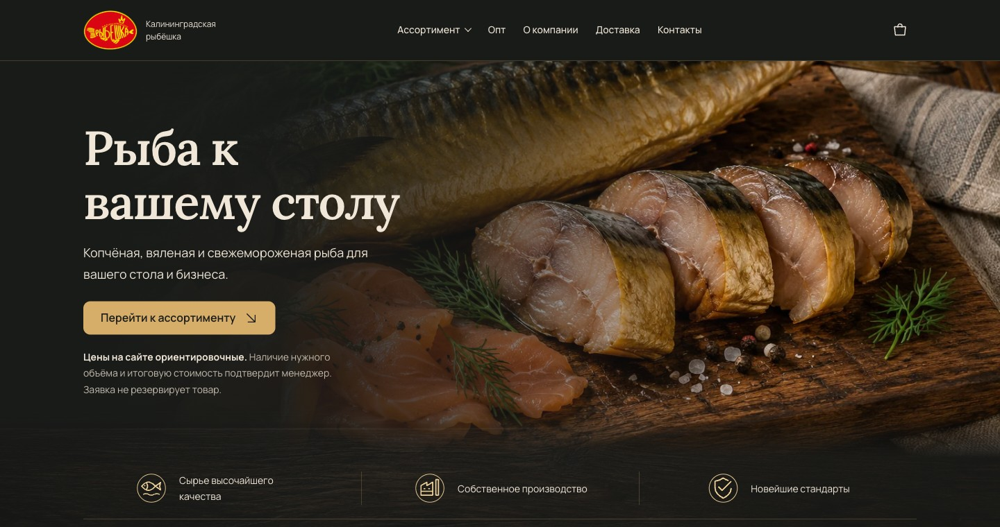

<p align="center">
  
</p>

<p align="center"><sub>DJANGO · STOREFRONT · BACKEND ENGINEERING</sub></p>

<h1 align="center">🐟 Рыбёшка39</h1>

<p align="center">
  <strong>Витрина настоящего рыбного магазина с розничной корзиной и оптовыми заявками</strong><br />
  От каталога и сохранения обращений до уведомлений и интеграции с МойСклад.
</p>

<p align="center">
  
  
  
  
  
  
</p>

<p align="center">
  <a href="#-о-проекте">О проекте</a> ·
  <a href="#-инженерные-решения">Инженерные решения</a> ·
  <a href="#-локальный-запуск">Локальный запуск</a> ·
  <a href="#-документация">Документация</a>
</p>

<p align="center">
  
  <br /><sub>Главная страница в локальном демонстрационном окружении</sub>
</p>

---

## 🧭 О проекте

**Рыбёшка39** — серверный веб-проект для магазина рыбы и морепродуктов.
Покупатель выбирает товары в каталоге, указывает желаемый вес и отправляет
розничную заявку. Для оптовых клиентов предусмотрена отдельная форма обращения.
Владелец работает с каталогом и заявками через защищённую панель.

Проект охватывает не только витрину, но и путь заявки: проверку данных и цен,
надёжное сохранение, фоновое уведомление продавца и работу с внешней учётной системой.

<table width="100%">
<tr>
<td width="50%" valign="top">
<h3>🛒 Витрина и корзина</h3>
<p>Категории и карточки товаров, корзина в сессии, расчёт по весу и выбор доставки или самовывоза.</p>
</td>
<td width="50%" valign="top">
<h3>📨 Розница и опт</h3>
<p>Два отдельных сценария обращения с проверкой данных, сохранением в PostgreSQL и уведомлением продавца.</p>
</td>
</tr>
<tr>
<td width="50%" valign="top">
<h3>🔗 МойСклад</h3>
<p>Связь товаров и цен с учётной системой; передача розничной заявки — по отдельному решению владельца.</p>
</td>
<td width="50%" valign="top">
<h3>🛡️ Панель владельца</h3>
<p>Управление каталогом и просмотр обращений с разграничением прав и двухфакторным входом по TOTP.</p>
</td>
</tr>
</table>

> **Бизнес-граница:** сайт принимает заявки, а наличие товара, окончательные
> условия продажи и оплату продавец согласовывает с покупателем. Онлайн-оплаты
> и автоматического резервирования остатков в проекте нет.

## ⚙ Инженерные решения

<table width="100%">
<tr>
<td width="50%" valign="top">
<h3>💾 Сохранность заявки</h3>
<p>Заявка, снимки позиций и задача уведомления сохраняются в одной транзакции. Повторная отправка формы обрабатывается идемпотентно.</p>
</td>
<td width="50%" valign="top">
<h3>⚖️ Актуальность корзины</h3>
<p>Расчёт выполняется на сервере через <code>Decimal</code>. При изменении состава или цены покупатель подтверждает обновлённую корзину.</p>
</td>
</tr>
<tr>
<td width="50%" valign="top">
<h3>📬 Фоновая доставка</h3>
<p>Transactional outbox в PostgreSQL и отдельный worker отправляют email с повторами и ручным разбором ошибок. <code>LISTEN/NOTIFY</code> ускоряет обнаружение задач.</p>
</td>
<td width="50%" valign="top">
<h3>🔐 Защита форм</h3>
<p>CSRF, серверная валидация, ограничение частоты и honeypot; принятая редакция согласия сохраняется вместе с заявкой.</p>
</td>
</tr>
</table>

Основные страницы отрисовываются через **Django Templates**; JavaScript
улучшает интерфейс, а ключевые сценарии остаются доступны без него.

## 🧩 Архитектура

Проект построен как модульный Django-монолит: у каждой части своя ответственность.

| Модуль | Назначение |
|---|---|
| [`catalog/`](catalog/) | Категории, товары и публичная витрина |
| [`orders/`](orders/) | Корзина и розничные заявки |
| [`inquiries/`](inquiries/) | Оптовые обращения |
| [`content/`](content/) | Содержимое страниц и редакции согласия |
| [`integrations/`](integrations/) | Уведомления и обмен с МойСклад |
| [`fishsite/`](fishsite/) | Настройки, маршруты и панель владельца |
| [`deploy/`](deploy/) | Инструменты выпуска и восстановления |

## 🧪 Качество и доставка изменений

В репозитории есть тесты бизнес-сценариев, интеграций и развёртывания.
**GitHub Actions** проверяет pull request: запускает Django-тесты на отдельной
PostgreSQL, тесты JavaScript и сценарии восстановления, проверяет миграции,
собирает Docker-образ и выполняет изолированную проверку контейнеров.

Процесс выпуска, допуск к развёртыванию и восстановление описаны в
[документации CI/CD](docs/ci-cd.md).

## 🚀 Локальный запуск

Понадобятся **Python 3.13**, **uv** и **PostgreSQL**; для сборки CSS — Node.js и npm.
Версии зависимостей закреплены в [pyproject.toml](pyproject.toml), [uv.lock](uv.lock)
и [frontend/package-lock.json](frontend/package-lock.json).

```sh
uv sync --frozen --python 3.13
cp .env.example .env
```

Копируйте пример только при отсутствии собственного `.env`. Создайте локальную БД
и роль PostgreSQL, заполните `DJANGO_DB_*` в `.env`, задайте уникальный
`DJANGO_SECRET_KEY` и для приватного `runserver` установите `DJANGO_DEBUG=true`.
Секрет можно сгенерировать локально:

```sh
.venv/bin/python -c 'import secrets; print(secrets.token_urlsafe(64))'
```

Храните результат в локальном `.env` или secret store. `.env` исключён из Git;
переменные процесса имеют приоритет над ним.

```sh
.venv/bin/python manage.py migrate
.venv/bin/python manage.py createsuperuser
.venv/bin/python manage.py runserver
```

Сайт: [localhost:8000](http://127.0.0.1:8000/) ·
панель: [localhost:8000/admin](http://127.0.0.1:8000/admin/).

Фотографии хранятся в `media/` и не входят в Git. Для изолированного
демо-окружения предусмотрена команда `manage.py seed_demo_catalog`: ей нужны
локальные изображения из списка в [команде наполнения](catalog/management/commands/seed_demo_catalog.py).
Цены и материалы этого набора демонстрационные.

<details>
<summary><strong>🎨 Сборка CSS</strong></summary>

```sh
npm --prefix frontend ci
npm --prefix frontend run build:css
# Во время разработки:
npm --prefix frontend run watch:css
```

Редактируйте исходники в `frontend/`; `static/css/site.css` — результат сборки.
Подробнее — в [дизайн-системе](docs/design-system.md).

</details>

<details>
<summary><strong>🧪 Запуск тестов</strong></summary>

Автотестам нужна отдельная PostgreSQL из [инструкции тестового окружения](docs/test-environment.md).
После первичной настройки:

```sh
.venv/bin/python scripts/test_postgres.py start
.venv/bin/python manage.py test tests --settings=fishsite.settings_test --noinput
```

</details>

## 📚 Документация

Начать изучение проекта можно с [индекса документации](docs/wiki/INDEX.md).

| Тема | Документ |
|---|---|
| Границы продукта и бизнес-правила | [MVP](docs/wiki/mvp-scope.md) |
| Сценарии заявок и корзины | [Заявки](docs/wiki/order-flow.md) · [Корзина](docs/wiki/cart.md) |
| Панель владельца и доступ | [Кабинет владельца](docs/backoffice.md) |
| Email, outbox и worker | [Уведомления](docs/wiki/notifications.md) · [Ручная проверка SMTP](docs/mailru-smtp-practical-test.md) |
| Каталог и передача в МойСклад | [Контракт интеграции](docs/MoySklad-plan.md) · [Эксплуатация](docs/moysklad-operations.md) |
| Карты и ключ Яндекса | [Карты](docs/delivery-map.md) |
| Docker и развёртывание | [Docker Compose](docs/deployment-compose.md) · [Спецификация запуска](docs/public-deployment-spec.md) |

---

<p align="center">
  <sub>Создано как коммерческий проект о бизнес-логике, интеграциях и надёжной работе с данными.</sub>
</p>
<p align="center">
  <a href="https://github.com/FrankHeels"></a>
  <a href="https://t.me/FrankHeels"></a>
</p>
