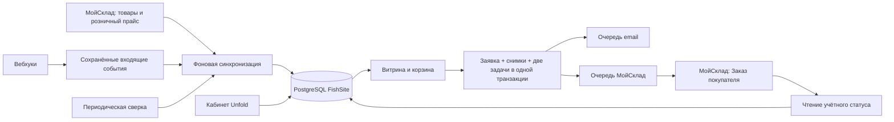

# FishSite: план реализации интеграции МойСклад

Дата исследования: **10 октября 2026 года**. Статус: **план реализации, код интеграции ещё не написан**.

План основан на исследовании текущей рабочей копии FishSite и официальной документации от указанной даты. Товары, розничные и оптовые цены за килограмм уже есть в МойСклад; **остатки сайт не получает и не учитывает, наличие подтверждает менеджер**. Тариф и объём ассортимента пока неизвестны. Доступ к реальному аккаунту и проверка его API в рамках исследования не выполнялись.

Связанный документ: [план Django Unfold Admin Panel](Unfold-Admin-plan.md). Этот план определяет модели и сервисы обмена, правила цены, экспорт заявок и эксплуатацию. Связанный план определяет интерфейсы управления этими возможностями, контент сайта и доступ сотрудников. Оба документа описывают части одного целевого релиза; разделение документов не переносит экспорт заказов на следующий релиз.

## 1. Целевой результат и границы

Владелец меняет товарный справочник и розничные цены в МойСклад. FishSite автоматически получает цены связанных товаров. После отправки покупателем розничной заявки FishSite сохраняет её у себя и автоматически создаёт документ «Заказ покупателя» в МойСклад.

Первый рабочий релиз интеграции включает весь путь от обновления прайса до экспорта заказов. Оформление кабинета владельца реализуется по [отдельному плану Unfold](Unfold-Admin-plan.md).

| Область | Решение |
|---|---|
| Остатки, резервы, поступления, списания | Вне интеграции. Нет запросов складских отчётов, локальных остатков, проверки наличия и автоматического резервирования |
| Продажа | Как сейчас: заявка, желаемый вес целыми килограммами, предварительная сумма; менеджер согласует наличие, фактический вес и доставку |
| Розничные цены | Из одного явно выбранного типа цены МойСклад; RUB и цена именно за кг |
| Оптовые цены | Сохраняются в МойСклад. В первом релизе не публикуются и не участвуют в расчётах сайта |
| Оптовая форма | Остаётся контактной заявкой без позиций. Автоматически создавать из неё товарный заказ не нужно |
| Справочник | МойСклад создаёт учётные позиции; сайт связывает их с существующими карточками либо готовит новые карточки к публикации |
| Работа менеджера | Учётные статусы и изменения экспортированного заказа — в МойСклад; сайт показывает результат |
| Оплата и отгрузка | Не создаются интеграцией; оплата на сайте не добавляется |
| Инфраструктура | Модульный Django-монолит, PostgreSQL, отдельный фоновый процесс интеграции |

Отсутствие товара на складе не должно скрывать карточку или блокировать заявку. Архивирование самой учётной позиции — другой случай: её нельзя продолжать предлагать как активный товар без разбора владельцем.

## 2. Что уже реализовано и что действительно нужно добавить

Исходная точка проверена при исследовании 10 октября 2026 года, включая незакоммиченные изменения рабочей копии. Перед реализацией повторно проверить затрагиваемые пути.

| Уже есть | Где | Как использовать |
|---|---|---|
| Django 5.2.17, Python 3.13, PostgreSQL | `pyproject.toml`, `fishsite/settings.py` | Сохраняем модульный монолит и существующее окружение |
| Товар, плоская категория, цена/кг, публикация, галерея | `catalog/models.py` | Добавляем внешнюю связь, сохраняя ID, slug, фотографии и редакционные данные |
| Неизменяемые снимки названия, цены, веса и суммы заявки | `orders/models.py` | Источник экспорта; дополняем внешней идентичностью и происхождением цены |
| Повторный POST возвращает ту же заявку | `orders/services/retail.py` | Сохраняем идемпотентность при добавлении второй очереди |
| Блокировка товаров, сверка подписанной корзины, подтверждение изменившейся цены | `orders/services/integration_handlers.py`, `orders/services/logic.py` | Распространяем на временную цену и изменение внешней связи |
| SMTP-outbox, lease, retry, LISTEN/NOTIFY | `integrations/notifications/`, `integrations/models.py` | Используем подход для отдельной очереди МойСклад |
| Архив принятой редакции согласия | `content/consent_revisions.py`, модели заявок | Сохраняем историю и запрет редактирования архива |

Нужно добавить внешние ID и артикулы, реестр сопоставления, происхождение и свежесть цены, временные исключения цены, экспорт и чтение статусов, очередь, вебхуки и диагностику. В `Order` пока нет учётного статуса и результата передачи в МойСклад.

Прежний документ MVP исключал реальную внешнюю интеграцию. При реализации обновить соответствующие требования, сохранив правило об отсутствии складского учёта.

## 3. Кто владеет какими данными

| Данные | Главный источник | Поведение второго приложения |
|---|---|---|
| UUID, артикул, учётное название, единица учёта | МойСклад | Django хранит служебную копию и показывает её для справки |
| Розничный прайс | МойСклад | Django хранит последнюю корректную цену и время её проверки |
| Оптовый прайс | МойСклад | В первом релизе сайт его не использует |
| Название на сайте, slug, тексты, фотографии | Django | Синхронизация их не перезаписывает |
| Категория сайта, порядок, публикация, популярность, рекомендации | Django | Классификация склада не меняет навигацию магазина |
| Временная цена сайта | Django, исключение с ограниченным сроком | В МойСклад прайс не меняется; заказ передаётся по цене принятой заявки |
| Исходная заявка и её снимки | Django | В МойСклад создаётся учётный документ на её основе |
| Статус продажи, согласованный состав, фактический вес и итог после передачи | МойСклад | Django показывает статус и при необходимости отдельный согласованный итог; исходную заявку не переписывает |
| Факт просмотра заявки, ответственный, внутренняя заметка | Django | Это служебная работа кабинета, не второй статус продажи |
| Состояние экспорта и повторы | Django | Не смешивается со статусами «подтверждён», «отгружен» и т. п. |

Один товар МойСклад соответствует одной карточке сайта. Изменение учётного названия не меняет публичное название и URL. «Восстановить название из МойСклад» допустимо отдельным осознанным действием.

## 4. Выбранный способ интеграции

Рекомендуется собственный небольшой адаптер JSON API 1.2 внутри `integrations/moysklad/`. Он покрывает конкретные операции FishSite, а не пытается воспроизвести весь API. Это позволяет сохранить существующие транзакции, снимки заявок и правила работы с килограммами.

| Подход | Применимость |
|---|---|
| Прямой JSON API и локальная очередь PostgreSQL | Основной вариант: полный контроль над ценой, соответствием товаров и повторным созданием документов |
| Готовый коннектор или low-code посредник | Можно использовать для временного обмена файлами; пригодность для неизменяемых снимков и защиты от дублей потребует отдельной проверки |
| CSV/Excel | Подходит для предварительного сопоставления товаров и ручной проверки; не обеспечивает непрерывный обмен |
| SDK-обёртка | Допустима после оценки сопровождения, но не обязательна для небольшого набора операций |

Веб-процесс читает каталог из PostgreSQL. Ни открытие карточки, ни оформление заявки не должны ожидать HTTP-ответа МойСклад.



Для начала достаточно отдельного процесса `process_moysklad`, без Redis и Celery. Он обслуживает сохранённые задачи, входящие события и периодическую сверку. При росте нагрузки можно заменить исполнитель, сохранив транзакционный outbox и доменные сервисы. Самостоятельный микросервис сейчас не нужен.

### Актуальные особенности API

- Базовый адрес: `https://api.moysklad.ru/api/remap/1.2/`. Для одной компании подходит Bearer-токен выделенного пользователя; обязательный заголовок сжатия — `Accept-Encoding: gzip`. Токен хранится в окружении сервера. Перевыпуск токена отзывает прежние токены этого пользователя — это нужно учитывать при ротации. [Общие сведения API](https://dev.moysklad.ru/doc/api/remap/1.2/#/general).
- Для обычного пользовательского токена на дату исследования действует **15 запросов за 3 секунды**; с 1 декабря 2026 документация предусматривает 11. Ограничение параллелизма пользователя — 5. Не закладывать устаревшее универсальное «45 запросов за 3 секунды»: лимиты зависят от способа доступа. [Ограничения](https://github.com/moysklad/api-remap-1.2-doc/blob/master/md/_restrictions.md).
- Продажные цены находятся в `salePrices`, их значение передаётся в копейках, тип цены — в `priceType`. Выбирать цену нужно по ID типа и проверять валюту. [Товар и цены продажи](https://github.com/moysklad/api-remap-1.2-doc/blob/master/md/dictionaries/_product.md).
- Для `customerorder` обязательны ссылки на организацию и контрагента. У позиции есть `assortment`, `quantity`, `price` и `reserve`. [Заказ покупателя](https://github.com/moysklad/api-remap-1.2-doc/blob/master/md/documents/_customerOrder.md).
- Переданный при создании `syncId` предназначен для безопасного повтора: повторный запрос с тем же ID возвращает ранее созданную сущность. [Назначение syncId](https://dev.moysklad.ru/doc/api/remap/1.2/#/general#3-naznachenie-polya-syncid).
- Вебхуки доступны на платных тарифах и в пробный период. Ожидаемый ответ — 200/204 в течение 1500 мс; после ограниченных повторов уведомление может быть утрачено. `requestId` сохраняется при повторе. [Вебхуки](https://github.com/moysklad/api-remap-1.2-doc/blob/master/md/dictionaries/_webhook.md).

Эти свойства проверены по документации, но возможности конкретного аккаунта, права пользователя, состав товара и сценарии автоматизации требуют проверки на этапе подключения.

## 5. Импорт и связь ассортимента

### Первичное подключение

1. Прочитать метаданные, типы цен, организацию и небольшой образец товаров; проверить права и тариф.
2. Выбрать конкретный ID розничной цены и валюту RUB. Не брать «первую цену» или цену с названием, которое может измениться.
3. Выполнить предварительную выгрузку без изменения публичного каталога: UUID, тип сущности, артикул/код, учётное название, единица, выбранная цена, архивность и время изменения.
4. Показать владельцу таблицу сопоставления: существующая карточка → кандидат МойСклад → цена → единица → результат проверки.
5. Артикул и название использовать как подсказки; неоднозначное совпадение не связывать автоматически. В текущем каталоге артикула ещё нет, поэтому потребуется первоначальное подтверждение соответствий.
6. Подтвердить связи, применить корректные цены, показать отчёт расхождений. Повторный импорт обновляет те же внешние UUID.
7. До включения экспорта проверить, что все публично заказываемые товары имеют однозначную рабочую связь.

Новые позиции МойСклад сначала попадают в раздел «Новые из МойСклад». Они не создают публичные карточки автоматически. Владелец выбирает категорию, проверяет цену, оформляет название и фото, затем публикует.

Для этого нужен небольшой промежуточный реестр импортированных позиций: существующая `Product` требует категорию и положительную цену. Нельзя обходить эти требования фиктивной категорией или ценой 0/1 рубль.

### Типы товаров и единицы

Базовый релиз поддерживает обычные товары `product`, у которых единица действительно килограмм. Если аудит выявит `variant`, поддержку модификаций нужно включить до импорта таких позиций: хранить `(entity_type, id)`, брать правильную цену и передавать ссылку именно на модификацию. Комплекты, услуги, серии и продажа упаковками требуют отдельного контракта и не должны молча становиться обычным товаром.

Не выводить единицу из текста названия. Если учёт ведётся в штуках или упаковках, факт наличия «цены за кг» в названии не делает `quantity` килограммами. Такая позиция остаётся в списке требующих настройки до исправления учётной единицы или явного проектирования коэффициента пересчёта.

### Изменения и исчезновение позиции

- Фотографии, описание, SEO, категория и публичное название сохраняются при каждом импорте.
- Архивность и подтверждённое удаление внешней позиции ставят отдельную блокировку публикации, сохраняя ручной флаг владельца и историю заявки. Восстановление требует проверки, без внезапной автопубликации.
- Ошибка сети, 403 или неполная страница импорта не равны удалению товара. Отсутствие в одной выдаче сначала вызывает проверку по ID.
- Изменение UUID через пересоздание товара не исправляется по совпавшему названию. Перепривязка — отдельное действие с журналом.
- Уже принятые заявки используют сохранённый внешний ID позиции; поздняя перепривязка карточки не меняет их экспорт задним числом.

## 6. Цены и синхронизация

### Нормальный режим

Полученную розничную цену преобразовывать из копеек в рубли через `Decimal`. Для API-значения 125050 сайт получает 1250,50 ₽/кг. Дробные копейки обрабатывать по одному документированному правилу округления, согласованному с текущим расчётом денег; двоичные `float` не должны участвовать в вычислениях.

Проверять наличие нужного типа цены, RUB, положительность и диапазон локального поля, единицу и архивность. Неверные данные не заменяют последнюю корректную цену. Для новой позиции без корректной цены публикация недоступна.

Поле `Product.price_per_kg` можно сохранить как последнюю корректную базовую цену. Для связанного товара оно становится read-only в кабинете. Дополнительно хранить происхождение, время последней проверки и время фактического изменения — успешная проверка неизменившейся цены тоже должна обновлять свежесть.

### Временная цена при сбое

Это отдельная функция, а не разблокировка обычного поля прайса:

- Действие «Установить временную цену»: сумма, обязательная причина, срок и автор. Предлагаемый срок по умолчанию — 24 часа, настраиваемый и требующий подтверждения владельца.
- На карточке одновременно видны цена сайта, последняя цена МойСклад, источник и момент окончания исключения.
- Синхронизация продолжает обновлять базовый прайс, не уничтожая активное исключение.
- После срока действует актуальная сохранённая базовая цена; при её устаревании кабинет показывает предупреждение. Уведомление об окончании не должно быть единственным механизмом возврата.
- Расчёт эффективной цены проверяет срок при каждом чтении. Остановившийся worker не продлевает временную цену.
- Возврат к прайсу, установка и замена исключения журналируются. Право на эту операцию отделено от редактирования описаний.

Нужен единый серверный механизм `effective_price(product, at)`, возвращающий сумму и источник. Через него должны проходить карточки, рекомендации, корзина, подписанный снимок, повторная проверка POST и создание `OrderItem`. Нельзя оставить часть кода читающей базовое поле напрямую. Один момент `at` используется на весь расчёт; блокировка `Product` сериализует изменение базовой/временной цены и принятие заказа.

Экспорт передаёт цену из `OrderItem.price_per_kg_snapshot`, включая временную. После возврата к прайсу уже принятая заявка не дорожает и не дешевеет.

### Как запускается синхронизация

Рекомендуемые начальные интервалы — настройки проекта, не обещания провайдера:

| Механизм | Назначение | Стартовая настройка |
|---|---|---|
| Webhook `product` CREATE/UPDATE/DELETE | Быстрая постановка обновления нужной позиции в очередь | Обработка обычно до 1 минуты при работающих сервисах |
| Инкрементальная сверка | Подхват пропущенных изменений | Каждые 5 минут |
| Полная сверка выбранного ассортимента | Проверка связей, цен, архивности и пропусков | Раз в сутки |
| «Обновить сейчас» | Проверка конкретного товара или запрос полной сверки | Фоновая задача, с объединением повторных нажатий |

Если вебхуки недоступны, периодическая сверка остаётся рабочим способом обмена. Не покупать другой тариф до проверки фактических потребностей и доступности нужных методов.

Инкрементальный импорт использует курсор и перекрывающееся временное окно. Продвигать курсор только после обработки всех страниц; один лишь `updated > last_timestamp` может пропустить записи на границе. Полная сверка проверяет сам выбранный прайс, а не только отметку изменения товара. Изменения через импорт, массовые операции и другие каналы отдельно проверяются на тестовом аккаунте.

Часовой пояс и точность времени API зафиксировать в контракте и явно преобразовывать во внутренний UTC; не считать строку без смещения автоматически временем UTC. Пагинацию, одинаковые timestamps и смену даты проверить отдельно. Проверку всех связей и архивности делать только после полного прохода, а не по частичному набору страниц.

Сетевой запрос выполняется вне транзакции. Запись проверенного результата — короткой транзакцией с версией источника, чтобы запоздавший ответ не затёр более свежие данные. Параллельные webhook и плановая сверка должны использовать одинаковый сервис применения цены.

### Отказоустойчивость чтения прайса

При недоступности API сайт продолжает работу с последними корректными ценами. На публичной стороне остаётся существующее объяснение о предварительном расчёте и подтверждении менеджером. Владелец видит возраст прайса и проблемы конкретных товаров.

Предлагаемые пороги: предупреждение после 15 минут без успешной плановой проверки, проблема интеграции после 60 минут. Ошибку отдельной позиции показывать отдельно: один исправный товар не должен окрашивать весь каталог в «всё актуально». Продолжительный сбой не обнуляет цены и не теряет новые заявки.

## 7. Создание заказа в МойСклад

### Транзакция на сайте

При принятии розничной заявки одной транзакцией сохранить:

1. `Order` и неизменяемые `OrderItem`.
2. Уже существующий `NotificationOutbox`.
3. Связь будущего документа МойСклад, стабильный `syncId` и задачу экспорта.
4. Снимок внешнего товара, единицы и источника цены для каждой позиции.

После commit покупатель получает номер заявки, корзина очищается. Email и экспорт выполняются независимо: сбой одного канала не отменяет другой. Постановка задания не должна происходить исключительно в `on_commit`: задача обязана уже находиться в БД к моменту commit. Callback можно использовать только для необязательного пробуждения процесса; PostgreSQL NOTIFY внутри транзакции также подходит. [Семантика транзакций Django](https://docs.djangoproject.com/en/5.2/topics/db/transactions/#performing-actions-after-commit).

Если внешняя связь повреждена, уже сохраняемую заявку не терять: задача получает понятное состояние «нужно сопоставить товар». Заказ в МойСклад не отправляется частично. Такой случай является исключением, а не штатным способом запуска с несопоставленным каталогом.

Для принятой позиции без внешнего UUID исправление оформляется отдельной проверенной привязкой экспорта с автором и причиной; она не выдаётся за исходный исторический снимок. До первой попытки передачи можно подготовить тело с этой привязкой. Если попытка уже выполнялась и результат неизвестен, сначала установить наличие документа по прежнему `syncId`; менять тело и повторять его вслепую нельзя.

### Контракт отправки

| Поле документа | Источник и правило |
|---|---|
| `syncId` | Сохранённый UUID, стабильный для этой заявки, аккаунта и окружения |
| `name` | Номер заявки FishSite, например `R-…`; проверить ограничения нумерации аккаунта |
| `externalCode` | Читаемая метка `fishsite:<environment>:<order_number>` для поиска; не самостоятельная гарантия уникальности |
| `organization` | Настроенное юрлицо МойСклад |
| `agent` | Явно выбранный контрагент по политике ниже |
| `positions[].assortment` | Сохранённые тип и UUID внешнего товара |
| `positions[].quantity` | Желаемый вес в кг из заявки |
| `positions[].price` | Снимок цены заявки, переведённый в копейки |
| `positions[].discount` | Явно 0 в первом релизе; подтвердить отсутствие неожиданного автоматического пересчёта |
| `positions[].reserve` | Явно 0; никаких резервов со стороны FishSite |
| `applicable` | Предлагаемый старт — `false`, до обработки менеджером; подтвердить на тестовом аккаунте |
| `state` | Настроенный начальный статус «Новая заявка с сайта» по его ID |
| `shipmentAddress` / дополнительные поля | Адрес, способ получения, контакты и комментарий по проверенному маппингу |
| `salesChannel` | Канал FishSite, если он настроен и доступен аккаунту |

Параметры НДС и включения НДС, обязательные дополнительные поля и валюту нужно согласовать с настройками организации и зафиксировать в преобразовании. Нельзя по умолчанию назначать всем товарам «без НДС» или пересчитывать цену по текущему прайсу в момент отправки.

Контрольный пример: цена 1250,50 ₽/кг и 3 кг → `price=125050`, `quantity=3`, предварительный итог 3751,50 ₽. После создания сравнить ответ API с ожидаемой суммой и позициями. Несовпадение требует разбора, а не повторного создания нового документа.

Согласовать ограничения строк. Сейчас сайт допускает длинный адрес/комментарий, тогда как API ограничивает отдельные поля. Важные данные нельзя молча обрезать: предусмотреть согласованные дополнительные поля или вложенную заметку с полным текстом и тест граничных длин. Политика должна быть определена до включения экспорта.

### Контрагент

Предлагаемый простой вариант первого релиза — заранее созданный контрагент «Розничные покупатели FishSite», а персональные контакты хранить в дополнительных полях каждого заказа. Его ID настраивается один раз; интеграция не меняет общую карточку на имя очередного покупателя.

Это проектное предложение, которое нужно подтвердить владельцу: оно удобно для гостевых заявок, но не создаёт персональную историю покупателей в CRM.

Если отдельные карточки клиентов обязательны, добавить отдельный подэтап: собственные внешние ключи, сохранённые связи и обработка неоднозначных совпадений. Телефон без подтверждения владения нельзя считать надёжным идентификатором человека или автоматически использовать для перезаписи существующего контрагента.

### Защита от дублей и неопределённого результата

- Уникальность задачи экспорта — по заявке и назначению; уникальность `syncId` и внешнего ID закрепить в БД.
- Перед первым HTTP-запросом сохранить подготовленное тело и его версию. Все автоматические повторы используют то же тело и тот же `syncId`, даже если владелец изменил настройки интеграции или текущий прайс.
- Timeout после POST означает «результат неизвестен». Выполнить поиск по `syncId` либо повторить исходное создание с ним; не генерировать новый ID.
- После успешного ответа сохранить ID и проверенную UI-ссылку документа. Отдельный тест: процесс упал после создания в МойСклад, но до записи результата в PostgreSQL.
- После передачи не отправлять исходные позиции повторным PUT: менеджер мог уже изменить фактический вес и состав. Повтор создания с `syncId` и редактирование существующего документа — разные операции.
- Если связанный документ удалён или найдено противоречивое соответствие, показать «требуется разбор». Автоматически восстанавливать удалённый заказ не нужно.
- Действие «Повторить передачу» возобновляет ту же задачу, а не создаёт новый документ.
- Если менеджер вручную создал документ во время сбоя, перед возобновлением нужен явный сценарий «Связать с существующим заказом» с проверкой номера, состава и отсутствия уже занятой связи. Простого поиска по названию недостаточно.

### Статусы

У заявки должны отдельно отображаться:

| Группа | Пример | Кто меняет |
|---|---|---|
| Приём на сайте | Принята, дата, номер | Django |
| Передача | Ожидает / передаётся / передана / повтор запланирован / нужен разбор | Фоновый процесс |
| Учётный статус | Название статуса из МойСклад | Менеджер в МойСклад |
| Работа в кабинете | Не просмотрена / просмотрена, ответственный, заметки | Сотрудник FishSite |

Настроить webhook `customerorder` и периодическое чтение статусов связанных документов: начальный ориентир — каждые 5 минут для активных, суточная проверка остальных. ID и названия статусов принадлежат аккаунту, поэтому нельзя жёстко прошить чужие «Новый/Оплачен/Отгружен». Неизвестный статус показывать как получен, с отметкой времени проверки.

Изменение учётного документа не переписывает исходные `OrderItem`. При необходимости показывать «Заявка покупателя» и «Согласовано в МойСклад» отдельными блоками. Сумму заявок на дашборде нельзя называть выручкой.

## 8. Модели и размещение кода

Имена ниже — предлагаемый контракт, а не готовые миграции.

| Модель / изменение | Назначение и ограничения |
|---|---|
| `MoySkladProduct` в `integrations` | Реестр внешних товаров и кандидатов: account/type/UUID, nullable one-to-one с `Product`, артикул, учётное название, единица, проверенный прайс, архивность, версия и даты синхронизации. Уникальность внешней идентичности |
| `MoySkladOrderLink` | One-to-one с `Order`, целевой аккаунт, стабильный `syncId`, nullable внешний UUID, снимок конфигурации и подготовленного payload, версия, учётный статус и дата проверки |
| `MoySkladTask` | Постоянная очередь операций: kind, ссылка на объект, deduplication key, status, attempts, next_attempt_at, lease token/deadline, безопасный код ошибки. Не содержит копий секретов |
| `MoySkladWebhookInbox` | Дедупликация доставки по `requestId` и аккаунту, минимальный валидированный список событий, время получения/обработки. Несколько событий одного запроса сохраняются вместе |
| `MoySkladSyncState` / `MoySkladSyncRun` | Курсоры, следующая сверка, heartbeat, даты успеха, охват и безопасные результаты запусков |
| `PriceOverride` в `catalog` | Сумма, начало/окончание, причина, автор и отмена; история исключений. Не более одного активированного исключения на товар, проверка срока при чтении |
| `OrderItem` | Неизменяемые снимки внешнего type/UUID, единицы, источника/времени цены и нужных для экспорта налоговых параметров; старые записи — nullable |
| `Product`: интеграционные поля | Причина интеграционной блокировки; текущий `price_per_kg` — базовая проверенная цена. Порядок, популярность и SEO добавляются по плану Unfold |

Использовать существующий Admin LogEntry для действий сотрудников; для применения прайса добавить компактную историю изменения цены: было/стало, источник, время, запуск синхронизации. Не копировать весь внешний JSON во все таблицы.

Границы модулей:

```text
integrations/moysklad/
    client.py          # HTTP, авторизация, timeout, лимиты
    contracts.py       # проверенные входные/выходные структуры
    mapping.py         # рубли/копейки, единицы, поля заказа
    catalog_sync.py    # импорт, сверка и связь товаров
    order_export.py    # создание документа и сверка результата
    status_sync.py     # чтение учётного статуса
    webhooks.py        # проверка и сохранение входящих событий
    queue.py           # claim, lease, retry
    worker.py          # исполнение и планирование
catalog/pricing.py     # эффективная цена и временное исключение
```

Модели и миграции остаются в существующих Django-приложениях. `orders` сохраняет транзакционную координацию заявки, `catalog` — правила цены и публикации, `content` — содержание страниц. Не превращать HTTP-адаптер в место бизнес-логики и ORM.

Редакционные поля товаров/категорий, служебная обработка заявок, `HomepageRecommendation`, `SiteSettings`, `HomepageSettings` и `fishsite/backoffice/` принадлежат [плану Unfold](Unfold-Admin-plan.md). Миграции общих приложений нужно согласовать, чтобы оба направления не добавили одну сущность дважды.

## 9. Безопасность обмена и доступ к операциям

Авторизованные действия кабинета вызывают сервисы интеграции с проверкой отдельных прав: `override_price`, `retry_moysklad_export`, `run_catalog_sync`, `manage_moysklad_mapping`. Группы пользователей, защищённые POST, CSRF и обязательная 2FA описаны в [плане Unfold](Unfold-Admin-plan.md). Проверка разрешений требуется и на входе в действие, и в сервисном пути, доступном сотруднику.

Токен МойСклад не доступен браузеру, владельцу в форме, логам и Git. Выделенному API-пользователю дать минимум необходимых прав. Управление вебхуками может потребовать администратора аккаунта; выполнить настройку отдельно, не повышая ради неё права повседневной учётной записи без необходимости.

Для входящего webhook:

- HTTPS, отдельный длинный секрет в адресе endpoint с возможностью ротации и исключением секрета из access-логов. Не считать `accountId` или `requestId` аутентификацией.
- Документация не даёт оснований проектировать обязательную HMAC-подпись, которой провайдер может не присылать. На этапе подключения проверить доступные средства проверки отправителя; событие использовать как сигнал перечитать объект через авторизованный API.
- Принимать только допустимые account/type/action/UUID, ограничить тело и частоту. Не выполнять HTTP-запрос по произвольному `href` из JSON: строить адрес из разрешённого типа/UUID и фиксированной базы. Аналогично проверять пагинацию и редиректы клиента, не пересылать токен на другой host.
- Сохранить inbox и задачи одной транзакцией; вернуть 200/204 только после успешной записи. Повтор уже сохранённого `requestId` безопасно подтвердить. Долгую обработку вынести в worker.
- В событии DELETE сначала проверить состояние авторизованным запросом. Поддельное событие не должно само по себе скрывать товар.

Перед передачей контактов в МойСклад отразить фактический процесс в документах обработки данных, определить доступ и сроки хранения, согласовать удаление локальных копий/payload и данных у провайдера. Это задача подготовки запуска, а не вывод о юридической готовности текущих проектов документов.

## 10. Очередь, мониторинг и эксплуатация

Новая очередь МойСклад отделена от SMTP. Нельзя менять `NotificationOutbox` так, чтобы одна неуспешная интеграция блокировала письмо или наоборот.

Worker использует короткий claim с `select_for_update(skip_locked=True)`, ограниченный lease и токен владельца. HTTP — вне транзакции; результат сохраняется только действующим владельцем. Пропущенный NOTIFY не теряет работу: процесс проверяет таблицу при старте, переподключении и по резервному таймеру. На каждый тип плановой сверки действует блокировка от двойного запуска.

| Ситуация | Реакция |
|---|---|
| Timeout, сеть, временный 5xx | Повтор с задержкой и случайным разбросом; для создания — тот же `syncId` |
| 429 | Учитывать заголовки лимитов и задержки МойСклад, снижать общий темп; не делать цикл мгновенных повторов |
| 401/403, отключённый API | Приостановить соответствующие обращения, сообщить владельцу, ждать исправления доступа |
| Ошибка обязательного поля/валюты/единицы | Требуется разбор; показать причину и затронутый объект |
| Исчерпан лимит попыток | Сохранить задачу в «требуется разбор», позволить контролируемое возобновление |
| Сбой отдельного товара | Изолировать ошибку, продолжить остальные; запуск отмечается как частично успешный |
| Пропуск/дубль/перестановка webhook | Inbox, повторное чтение актуальной сущности и периодическая сверка |

Предлагаемые настройки старта: один worker, не более двух API-запросов в секунду с общим ограничителем, connect timeout 5 с, read timeout 20 с, ограниченный общий бюджет операции, lease с запасом относительно него. Повторы, например 30 с → 2 мин → 10 мин → 30 мин, до 8 попыток; окончательные значения определить нагрузочной проверкой. Отправка заказов приоритетна, но не должна полностью вытеснять обновление прайса.

На странице интеграции различать: время проверки доступа, успешной сверки каталога, обновления отдельного товара, успешного экспорта и heartbeat worker. Показывать очередь и возраст старейшей заявки, число ошибок и активные временные цены.

Технические логи: ID операции/заявки, длительность, код результата, число попыток. Без Authorization, телефонов, адресов, тела заявки и необработанного текста исключений API. Полные контакты доступны только в защищённой карточке заявки.

Развёртывание: отдельный сервис процесса интеграции в существующем окружении, автоматический перезапуск, graceful shutdown, резервное копирование БД и media. После восстановления БД сначала сверить внешние `syncId` и очередь, затем возобновлять экспорт. Утрата свежих локальных строк после восстановления старого backup может оставить уже созданные внешние документы: нужен отчёт сверки по префиксу FishSite и интервалу восстановления, а не слепой массовый повтор.

## 11. Контракт с административной панелью

Интеграция предоставляет кабинету локальные данные и команды. Рендеринг страниц не обращается к внешнему API.

| Потребность кабинета | Ответственность интеграции | Ответственность Unfold |
|---|---|---|
| Новые позиции и сопоставление | Реестр кандидатов, валидация типа/единицы/цены, безопасное создание и изменение связи | Таблица кандидатов, поиск, подтверждение выбора и оформление карточки |
| Цена товара | `effective_price`, модель `PriceOverride`, журнал и ограничения | Read-only прайс, форма временной цены, причина/срок, история |
| Повтор передачи | Возобновление прежней задачи с прежним `syncId` и проверками состояния | Действие с правом доступа и понятный результат |
| Проверить цены | Дедупликация и сохранение фоновой задачи | Кнопка, статус ожидания и завершения |
| Заявка | Снимки, внешняя связь, статус передачи, учётный статус и время проверки | Read-only отображение; служебные заметки и ответственный живут отдельно |
| Монитор обмена | Heartbeat, охват прайса, возраст очереди, безопасные коды ошибок | Дашборд, фильтры и объяснение следующего действия |

Модель и правила временной цены реализуются один раз в этом плане. Формы, права и визуальное представление — в плане Unfold. Поля локальной обработки `Order`/`Inquiry` также принадлежат плану кабинета и не меняют статус продажи в МойСклад.

Прайс и экспорт можно разрабатывать и тестировать до завершения кабинета, но живой экспорт включается после готовности защищённой диагностики и восстановления. Должны быть доступны разбор несопоставленных позиций, повтор передачи и явная привязка вручную созданного документа.

## 12. Порядок реализации и условия завершения

| Этап | Работа | Результат / критерий перехода |
|---|---|---|
| 0. Проверка аккаунта и контракта | Тариф, права, ID прайса/валюты/организации/контрагента/статуса; 5–10 типичных товаров; единицы, variants, НДС, обязательные поля, сценарии аккаунта | Маппинг и контрольный заказ в выделенном тестовом окружении; нет резервов, сумма совпадает |
| 1. Модели и безопасная миграция | Реестр связи, очередь, order link, снимки, временная цена, журнал; настройки отключены по умолчанию | Карточки/URL/заявки сохранены, старые заявки не поставлены на экспорт |
| 2. Клиент и фоновая обработка | API-клиент, gzip, timeout, throttling, lease/retry, preflight, heartbeat, тестовые адаптеры | Проверены 429, 401, timeout, падение процесса и восстановление задачи |
| 3. Прайс и сопоставление | Пробный импорт, подтверждение соответствий, все читатели effective price, правила публикации | Повторный импорт не плодит карточки, контент не теряется, цена согласована на всех экранах |
| 4. Розничная заявка → МойСклад | Вторая задача в транзакции, snapshot-mapping, создание с syncId, результат и статусы | Одна заявка соответствует одному документу при повторе и сбое; недоступность API не теряет заявку |
| 5. Вебхуки и регулярная сверка | Inbox, дедупликация, курсоры, полная сверка, статусы, мониторинг | Потеря webhook исправляется сверкой, дубли не меняют результат |
| 6. Совместная приёмка и ввод | Подключение действий и диагностики кабинета; права, HTTPS, документы, демонстрация владельцу | Все заказываемые товары связаны, экспорт включён с понятной границей по времени |

Все этапы входят в первый релиз интеграции. Вебхуки можно включить после периодической сверки внутри развёртывания. Экраны и роль владельца разрабатываются по [плану Unfold](Unfold-Admin-plan.md).

### Основные зоны изменения

| Зона | Файлы / области |
|---|---|
| Зависимости и настройки | `pyproject.toml`, `uv.lock`, `fishsite/settings.py`, `fishsite/urls.py`, `.env.example`, `.env.compose.example`, конфигурация запуска worker |
| Каталог и цена | `catalog/models.py`, `catalog/views.py`, `catalog/context_processors.py`, новый `catalog/pricing.py`, миграции; все публичные читатели цены |
| Заявки и корзина | `orders/models.py`, `orders/services/logic.py`, `orders/services/integration_handlers.py`, `orders/services/retail.py`, `orders/cart/` |
| Интеграция | `integrations/moysklad/`, модели, миграции, URLs webhook, команды `check_moysklad`, `sync_moysklad_catalog`, `process_moysklad` |
| Тесты | Тесты МойСклад/pricing, transaction/снимков/публикации и изолированный тестовый профиль |

Все новые имена команд — предложения для реализации. Команда `check_moysklad` по умолчанию должна быть read-only: проверять доступ и необходимые справочники, не создавать заказ и не регистрировать вебхуки скрытым побочным действием.

При реализации обновить `docs/wiki/mvp-scope.md`, `entities.md`, `order-flow.md`, `operations.md`, `docs/data-layer.md`, `frontend-contract.md`, инструкции тестов/деплоя и README. В документах уведомлений описать независимость двух каналов. Обновление требований к интерфейсу и дизайн-системы относится к плану Unfold.

## 13. Проверки и приёмка

| Область | Обязательные сценарии |
|---|---|
| Товары | Повторный импорт; одинаковые названия/артикулы; две попытки связать один UUID; не-kg; variant; архивирование; удаление; неполная выдача; недоступный объект |
| Цены | Правильный priceType; копейки/рубли; отсутствие цены; 0/отрицательная/слишком большая; неверная валюта; округление; старая версия ответа после новой |
| Временная цена | Установка с правом/без права; причина и срок; обновление базового прайса во время исключения; истечение при остановленном worker; единая цена на всех экранах |
| Заявка | Изменение цены или связи между показом и POST; повторное подтверждение; конкурентный повтор формы; rollback всех записей и обеих задач; пустая корзина/старый дробный вес |
| Экспорт | Цена и внешний ID из снимка; долгий сбой; потеря ответа после успешного создания; падение до локального commit результата; два worker; нулевой резерв; отказ одной позиции; сумма ответа не совпала |
| Вебхуки | Дубликат requestId; несколько событий в одном запросе; неправильный аккаунт; внешний host в href; события не по порядку; потерянное событие; возврат успеха только после записи inbox |
| Статусы | Изменение/переименование в МойСклад; неизвестный статус; удалённый документ; менеджер изменил состав — сайт не перезаписал его |
| Регрессии | Сессионная корзина, шаг 1 кг, снимки, согласия, оптовая форма, независимая email-очередь, обычные страницы |
| Восстановление | Перезапуск, просроченный lease, пропущенный сигнал, восстановление backup и сверка уже созданных документов |

Автоматические тесты работают с mock/local fake API и существующей изолированной PostgreSQL на 15432 с `fishsite.settings_test`. Не использовать реальные API-токены, production-БД и отправку email. Настройки новых subprocess также должны проходить существующие ограничения тестового окружения. Транзакции и гонки — через `TransactionTestCase` и отдельные соединения.

Отдельная проверка реального API выполняется на согласованном тестовом аккаунте/наборе данных. Она должна подтвердить контракт, который нельзя доказать моками: права, тип цены, kg, НДС, syncId, поле состояния, отсутствие резервирования и действующие автоматические сценарии МойСклад.

Совместная демонстрация владельцу выполняется с готовыми экранами из [плана Unfold](Unfold-Admin-plan.md):

1. Изменить розничную цену в МойСклад и увидеть её на карточке/в корзине в пределах согласованного интервала.
2. Создать новую учётную позицию, оформить её в кабинете и опубликовать без повторного ввода прайса.
3. Изменить фото, название и рекомендацию; очередная синхронизация сохраняет оформление.
4. Отправить заявку и открыть соответствующий заказ МойСклад с теми же ценами и весом.
5. Повторить отправку/экспорт и убедиться, что второго документа нет.
6. Отключить API на тестовом окружении: заявка сохранена, письмо не зависит от экспорта, проблема понятна владельцу; после восстановления задача завершается.
7. Поставить временную цену и проверить возврат к прайсу по сроку.
8. Убедиться, что нулевой/отрицательный остаток никак не влияет на сайт и ни один резерв не создан интеграцией.

## 14. Включение и откат

Использовать раздельные переключатели чтения прайса, экспорта, чтения статусов и приёма вебхуков. Остановка экспорта означает остановку отправки, а не удаления очереди; новые заявки по-прежнему сохраняют задачу для последующей доставки.

Граница включения состоит из двух настроек: момент начала регистрации задач для новых заявок и разрешение worker отправлять их. До первого подключения старые заявки не ставятся в очередь. После подключения временное отключение отправки уже не отменяет регистрацию новых задач. Тестовое и рабочее окружения используют разные аккаунты/токены либо строго разделённые тестовые данные и пространства `syncId`; копия production-БД на стенде не имеет права запускать реальный экспорт.

Последовательность: backup → добавочные миграции → предварительный импорт → проверка связей → включение прайса на выбранном ассортименте → контрольный заказ → включение экспорта с зафиксированного момента → вебхуки → наблюдение за полным циклом сверки.

Исторические заявки автоматически не экспортировать. Отдельный перенос истории возможен только по явному диапазону с предварительным отчётом и проверкой уже существующих документов. Старые снимки не заполнять современными ценами или соответствиями, выдавая их за исторические.

Откат: выключить нужный поток, остановить worker, сохранить очередь и связи, оставить последнюю корректную цену и текущий публичный каталог. До отката версии приложения проверить её совместимость с новыми таблицами; нельзя вернуть код, который продолжит принимать заявки без записи задач экспорта. Ранее созданные документы МойСклад не удаляются откатом сайта.

## 15. Что ещё нужно определить до подключения

Это оставшиеся входные данные для этапа 0, а не препятствие для подготовки кода:

- Тариф и доступные права API/вебхуков; приблизительное число товаров и частота изменения цен.
- ID розничного типа цены, подтверждение RUB и единицы kg для всех продаваемых позиций.
- Есть ли модификации/упаковки, которые должны продаваться на сайте.
- Организация, налоговые настройки, начальный статус и обязательные поля заказа.
- Согласие на общего розничного контрагента либо необходимость отдельных клиентских карточек.
- Допустимая задержка обновления прайса и передачи заявки; срок временной цены и порядок работы при длительном сбое.
- Кто разбирает ошибки обмена; роли сотрудников и восстановление доступа 2FA уточняются по [плану Unfold](Unfold-Admin-plan.md).

Оптовой прайс, персональные цены, клиентский кабинет, расчёт доставки и автоматическое изменение учётных заказов можно проектировать отдельными задачами после этого релиза. Складские остатки не входят в план по подтверждённому решению владельца.

[План административной панели](Unfold-Admin-plan.md) · [Индекс документации](wiki/INDEX.md)
